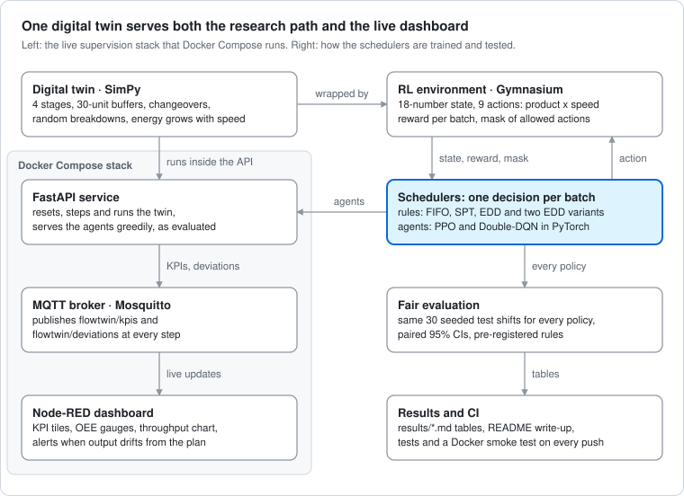
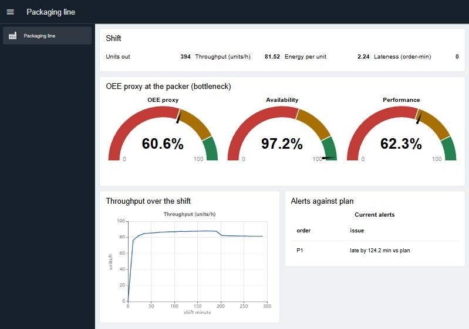

# FlowTwin — RL production scheduling on a digital twin of a packaging line

[](https://github.com/louayakermi2816-gif/flowtwin/actions/workflows/tests.yml)
[](https://github.com/louayakermi2816-gif/flowtwin/releases/latest)
[](LICENSE)


FlowTwin is a discrete-event **digital twin** of a multi-product bottling/packaging
line (filler → capper → labeller → packer) with finite buffers, product
changeovers, stochastic breakdowns and energy-dependent line speed, exposed as a
**Gymnasium** environment. Scheduling decisions — *which product batch to launch
next, at which speed* — are taken by dispatching heuristics (FIFO, SPT, EDD) or by
reinforcement-learning agents written from scratch in **PyTorch** (PPO and
Double-DQN); `train_ppo.py --sb3` adds a cross-check against Stable-Baselines3
(sb3-contrib MaskablePPO). A **FastAPI** service exposes the twin and publishes its
KPIs over **MQTT** to a **Node-RED** dashboard that shows an OEE proxy of the
bottleneck and **planned-vs-actual deviation alerts**.



## Key findings

- **Fair comparison.** Every policy plays the same 30 seeded shifts (same orders, same
  breakdowns), differences are paired with 95% confidence intervals, and each study's
  protocol and decision rule were committed before its runs.
- **At the default weights**, PPO (411.4 ± 47.8) beats earliest-due-date by +71.3 ± 4.2 on
  all 30 shifts and comes within 2 % of the best rule, EDD at low speed (418.8 ± 46.8), by
  saving energy rather than by scheduling better. The from-scratch PPO matches
  sb3-contrib MaskablePPO (411.1 ± 45.0).
- **When lateness matters**, no agent beats the slack-aware EDD rule at any weight tested.
  Five pilots trace the gap to discovering the launch order: given the order, or started
  from the rule, the agents reach it within the noise; asked once per shift, Double-DQN
  finds the EDD order on 17 to 18 of 30 shifts.
- **Engineering.** A FastAPI service streams KPIs over MQTT to a Node-RED dashboard (OEE
  proxy, plan-deviation alerts), deployed with Docker Compose; 60 tests, on Python 3.11 to
  3.13, and a Docker smoke test of the stack run on every push.

Status: **v0.3.1** (October 2026), complete. The tables in [`results/`](results/) are
produced by the scripts below; numbers are only reported once measured.

## Why

Production scheduling in real lines is dominated by changeover losses, breakdowns
and energy cost — the same trade-offs studied in simulation-based RL scheduling
research. FlowTwin rebuilds an Arena bottling-line coursework model in code so the
policy that runs it can be *learned* and compared fairly against the heuristics a
planner would use.

## Quick start

```bash
git clone https://github.com/louayakermi2816-gif/flowtwin.git && cd flowtwin
python -m venv .venv && .venv/Scripts/activate        # Windows; use source .venv/bin/activate on Linux/macOS
pip install -r requirements.txt -c constraints.txt     # FlowTwin with the versions the tests and the image use
pytest -q                                              # 60 tests, about 4 minutes
```

On Linux, install the CPU build of PyTorch first to skip the 2 GB CUDA download:
`pip install torch==2.14.0 --index-url https://download.pytorch.org/whl/cpu`.

**Trained agents.** Checkpoints are not in git. The ones behind the published tables are
attached to the [v0.3.1 release](https://github.com/louayakermi2816-gif/flowtwin/releases/tag/v0.3.1):
put `ppo.pt` and `dqn.pt` in `models/` (`gh release download v0.3.1 --pattern "*.pt" --dir models`),
or train them with the commands below.

```bash
python scripts/run_baselines.py --episodes 30          # FIFO / SPT / EDD / EDD-low / random -> results/baselines.md
python scripts/train_ppo.py --steps 100000 --sb3       # our PPO vs sb3-contrib MaskablePPO vs heuristics
python scripts/train_dqn.py --steps 100000             # Double-DQN vs heuristics
python scripts/run_sensitivity.py --workers 2          # lateness-weight study -> results/sensitivity.md
python scripts/run_dense_pilot.py --workers 2          # v0.3 pilot: dense lateness signal -> results/dense_lateness_pilot.md
python scripts/run_rule_pilot.py --workers 2           # v0.3 pilot: agents pick a rule and a speed -> results/rule_selection_pilot.md
python scripts/run_speed_pilot.py --workers 2          # v0.3 pilot: EDD order, agents pick the speed -> results/speed_only_pilot.md
python scripts/run_warm_start_pilot.py --workers 2     # v0.3 pilot: PPO starts from the slack rule -> results/warm_start_pilot.md
python scripts/run_order_pilot.py --workers 2          # v0.3 pilot: one launch-order decision per shift -> results/order_first_pilot.md
python scripts/inspect_agent.py --agent ppo --model models/ppo.pt --trace 1000   # what an agent actually does
uvicorn flowtwin.api:app --reload                      # http://127.0.0.1:8000/docs (MODEL_PPO=models/ppo.pt serves the agent)
```

Training is deterministic for a given seed and thread count: the commands above
reproduce the tables in `results/` exactly. The live demo is described below.

## The twin

| Element | Model |
|---|---|
| Stages | 4 in series, each with base time per unit and product-specific factor |
| Buffers | finite `simpy.Store`s (default capacity 30) → blocking when full |
| Changeover | fixed loss at *every* stage when the product variant switches |
| Breakdowns | exponential time-to-failure / time-to-repair per stage |
| Speed | 3 line-speed levels: faster processing, super-linear energy |
| Demand | one order per product with random quantity and due date; 12 h shift horizon |

**Decision** (one per launched batch): `Discrete(n_products × n_speeds)`. Products with no
remaining demand are masked (`env.action_masks()`); the agents never choose them.
**Observation**: buffer fills, inlet fill, stage down flags, product on stage 0,
remaining demand fraction, due-date urgency, elapsed time.
**Reward**: `+units − 0.5·changeover_min − 0.15·energy − 0.10·tardiness_min − 5·invalid`
with a terminal penalty per unmet unit; the invalid term only applies to unmasked
policies. Weights live in `flowtwin/config.py`. The end of the shift terminates the
episode (the clock is observed), it is not a time-limit truncation.

## Planned vs actual

`flowtwin/plan.py` runs the EDD schedule on a breakdown-free copy of the line to
obtain the *plan*; the live twin is the *actual*. `GET /twin/deviations` returns the
gap per product and a flow alert when output falls a batch behind plan — the same
signal a planner watches in a sawmill or packaging plant.

## Live demo

The API, a Mosquitto broker and a Node-RED dashboard run together with Docker
Compose. Put the trained agents in `models/` first: download them from the
[release](https://github.com/louayakermi2816-gif/flowtwin/releases/tag/v0.3.1) as in the
Quick start, or train them (about 20 minutes, deterministic):

```bash
python scripts/train_ppo.py --steps 100000 --sb3 && python scripts/train_dqn.py --steps 100000   # or download them
docker compose up --build -d
python scripts/demo_feed.py --policy ppo --interval 1    # steps shifts through the API
```



*The dashboard during a shift run by the trained PPO agent: one breakdown has cost the
packer 2.8 % availability, the agent's low line speed keeps performance at 62 %, and the
plan check flags product P1 running 124 minutes late.*

- **Dashboard** at http://localhost:1880/dashboard: units out, throughput, energy
  per unit, lateness, the OEE proxy and its two factors, throughput over the shift
  and the current alerts against plan. Node-RED editor at http://localhost:1880,
  API docs at http://localhost:8000/docs.
- The API serves the trained agents **greedily, as they were evaluated**: on
  evaluation shift 1000 the containerised PPO reproduces its evaluated result
  (return 416.5596, 686 units, 285.5 min of lateness) to the last digit.

**OEE proxy** (`flowtwin/oee.py`), defined on the bottleneck (the packer), over the
elapsed shift time, with no planned stops:
availability = (elapsed − packer downtime − packer changeover) / elapsed;
performance = ideal packer time at the fastest speed for the units produced / run time;
quality = 1, since scrap is not modelled.

If your network intercepts HTTPS (antivirus "HTTPS scanning" or a corporate proxy),
pip and npm inside the image builds fail with `CERTIFICATE_VERIFY_FAILED`: add the
interceptor's root certificate to the build or switch the scanning off. On the host,
`pip install --use-feature=truststore ...` uses the operating system's certificates; set
`PIP_USE_FEATURE=truststore` in the environment so pip's build step uses them too.

## Deploy

`docker-compose.yml` is the deployment: the API serving the trained agents, the MQTT broker
and the Node-RED dashboard. CI builds it from a clean checkout and smoke-tests it (API,
broker messages, a full shift, the dashboard) on every push.

1. **Agents.** Download `ppo.pt` and `dqn.pt` from the release into `models/`, or train them
   (the first command of the live demo, about 20 minutes and deterministic).
   Without them the API still runs and serves the rules; `/health` lists the loaded agents.
2. **Settings.** `cp .env.example .env`. `FLOWTWIN_BIND` (default `127.0.0.1`) is the
   address the three services listen on; `FLOWTWIN_RESTART=unless-stopped` keeps the stack
   up across reboots and Docker restarts (default `no`).
3. **Start.** `docker compose up --build -d`. `docker compose ps` shows the API as healthy
   once `/health` answers.
4. **Check.** `curl http://127.0.0.1:8000/health` returns
   `{"status":"ok","mqtt":true,"models":["ppo","dqn"]}`; the dashboard is at
   http://127.0.0.1:1880/dashboard.
5. **Update or stop.** `git pull && docker compose up --build -d`; `docker compose down`
   stops it and keeps the agents in `models/`.

Before setting `FLOWTWIN_BIND=0.0.0.0`: the Node-RED editor and the MQTT broker have no
authentication. Put them behind a reverse proxy with TLS and a login, set `adminAuth` in
Node-RED's settings and give Mosquitto a password file (`allow_anonymous false`). The image
installs the exact versions in `constraints.txt`, the ones the tests run with. Flows edited
in the Node-RED editor live in the container and are replaced by `node-red/flows.json` on
the next build.

## Results

30 evaluation episodes (seeds 1000–1029). Every policy sees the same orders and the
same breakdown times, so besides mean ± std over episodes the tables give **paired
differences**: the mean per-episode difference ± 95 % CI (Student t), which removes the
demand variance that dominates the std. Agents: 100k training decisions on CPU,
training seed 0, default reward weights. Rows are combined from
[`results/ppo_vs_heuristics.md`](results/ppo_vs_heuristics.md) and [`results/dqn_vs_heuristics.md`](results/dqn_vs_heuristics.md) (their heuristic rows
are identical); [`results/baselines.md`](results/baselines.md) adds the random policy.

| policy | return | units_out | throughput_per_h | changeover_min | energy | tardiness_min | unmet_units | invalid_actions |
|---|---|---|---|---|---|---|---|---|
| fifo | 335.2 ± 37.6 | 663.7 ± 74.4 | 86.8 ± 5.1 | 64.0 ± 0.0 | 1924.8 ± 215.8 | 78.4 ± 92.3 | 0.0 ± 0.0 | 0.0 ± 0.0 |
| spt | 334.7 ± 40.3 | 663.7 ± 74.4 | 86.6 ± 4.9 | 64.0 ± 0.0 | 1924.8 ± 215.8 | 83.4 ± 76.6 | 0.0 ± 0.0 | 0.0 ± 0.0 |
| edd | 340.1 ± 40.4 | 663.7 ± 74.4 | 87.2 ± 4.7 | 64.0 ± 0.0 | 1924.8 ± 215.8 | 29.1 ± 67.5 | 0.0 ± 0.0 | 0.0 ± 0.0 |
| edd_low | 418.8 ± 46.8 | 663.7 ± 74.4 | 70.9 ± 3.5 | 64.0 ± 0.0 | 1347.4 ± 151.0 | 108.0 ± 123.5 | 0.0 ± 0.0 | 0.0 ± 0.0 |
| ppo (ours) | 411.4 ± 47.8 | 663.7 ± 74.4 | 70.8 ± 3.6 | 64.0 ± 0.0 | 1347.4 ± 151.0 | 182.7 ± 122.1 | 0.0 ± 0.0 | 0.0 ± 0.0 |
| maskable ppo (sb3) | 411.1 ± 45.0 | 663.7 ± 74.4 | 71.0 ± 3.5 | 64.0 ± 0.0 | 1347.4 ± 151.0 | 184.9 ± 142.0 | 0.0 ± 0.0 | 0.0 ± 0.0 |
| double-dqn | 390.7 ± 55.5 | 663.7 ± 74.4 | 69.9 ± 4.0 | 90.7 ± 28.7 | 1353.6 ± 154.5 | 247.0 ± 148.4 | 0.0 ± 0.0 | 0.0 ± 0.0 |

| paired vs edd | Δ return | Δ tardiness_min | Δ energy | higher return |
|---|---|---|---|---|
| edd_low | +78.7 ± 2.9 | +78.9 ± 25.2 | -577.4 ± 24.6 | 30/30 |
| ppo (ours) | +71.3 ± 4.2 | +153.5 ± 35.1 | -577.4 ± 24.6 | 30/30 |
| maskable ppo (sb3) | +71.0 ± 3.7 | +155.7 ± 41.0 | -577.4 ± 24.6 | 30/30 |
| double-dqn | +50.6 ± 9.1 | +217.8 ± 45.9 | -571.2 ± 23.5 | 29/30 |

| paired vs edd_low | Δ return | Δ tardiness_min | Δ energy | higher return |
|---|---|---|---|---|
| ppo (ours) | -7.5 ± 3.0 | +74.7 ± 29.9 | +0.0 ± 0.0 | 2/30 (6 tied) |
| maskable ppo (sb3) | -7.7 ± 3.1 | +76.9 ± 30.9 | +0.0 ± 0.0 | 1/30 (7 tied) |
| double-dqn | -28.2 ± 8.3 | +139.0 ± 43.3 | +6.2 ± 3.1 | 1/30 |

**Reading the results**

- With the default weights energy dominates the objective: for EDD it costs
  0.15 × 1924.8 = 288.7 of the return, tardiness only 0.10 × 29.1 = 2.9. Running the
  same EDD sequence at low speed (`edd_low`) raises the return by +78.7 ± 2.9 on 30/30
  episodes while tardiness grows by +78.9 ± 25.2 min. Any policy that slows the line
  therefore "beats EDD"; `edd_low` is the fair reference.
- **PPO (ours)** beats EDD by +71.3 ± 4.2 on 30/30 episodes and ends 7.5 ± 3.0 below
  `edd_low`. It runs every batch at low speed and launches the products in one fixed
  order (2 → 0 → 1 on all 30 episodes, `scripts/inspect_agent.py`) whatever the due
  dates, so its tardiness is 182.7 min against 29.1 for EDD. It learned the energy
  lever, not scheduling.
- **Double-DQN** beats EDD by +50.6 ± 9.1 (29/30) and ends 28.2 ± 8.3 below `edd_low`:
  98.6 % of batches at low speed, mostly the same 2 → 0 → 1 order, plus extra product
  switches (changeover 90.7 vs 64.0 min).
- **MaskablePPO (sb3-contrib)**, the library cross-check trained with the same masks
  and reward scale, scores 411.1 ± 45.0, within 0.3 of our PPO (paired against EDD:
  +71.0 ± 3.7 against +71.3 ± 4.2), which supports the from-scratch implementation. It
  learns the same kind of policy: its results equal FIFO at low speed on all 30 episodes.
- No agent uses the due dates. With `w_tardiness = 0.10` lateness is about 1 % of the
  return, so a better sequence is worth a few points per episode against an
  episode-to-episode std of 40–56. The study below prices lateness higher.

**Training-seed robustness** (same evaluation episodes, `--seed 1` / `--seed 2`):

| agent | training seed | return | Δ return vs edd | Δ return vs edd_low |
|---|---|---|---|---|
| PPO (ours) | 0 | 411.4 ± 47.8 | +71.3 ± 4.2 | -7.5 ± 3.0 |
| PPO (ours) | 1 | 411.4 ± 47.8 | +71.3 ± 4.2 | -7.5 ± 3.0 |
| PPO (ours) | 2 | 410.9 ± 43.8 | +70.8 ± 3.5 | -8.0 ± 3.2 |
| Double-DQN | 0 | 390.7 ± 55.5 | +50.6 ± 9.1 | -28.2 ± 8.3 |
| Double-DQN | 1 | 373.2 ± 60.2 | +33.1 ± 12.8 | -45.6 ± 11.4 |
| Double-DQN | 2 | 384.6 ± 51.2 | +44.5 ± 7.4 | -34.2 ± 6.6 |

PPO seeds 0 and 1 converge to the same fixed schedule (different weights, identical
actions), hence identical rows; seed 2 learns the order 1 → 0 → 2.

### Objective sensitivity ([`results/sensitivity.md`](results/sensitivity.md))

Does RL beat the rules once lateness costs more? A pre-registered study (protocol and
decision rule committed before any of its runs, in `02f0b9d`) re-ran the rules and both
agents, 3 training seeds each, at three lateness weights. Each agent is compared with
the best rule chosen on separate training seeds, including `edd_slack`, which keeps the
EDD order but speeds up an order projected to be late (margin tuned on training seeds).
An agent "beats the rules" if its paired 95% CI against that rule is above 0 for at
least 2 of its 3 seeds. `python scripts/run_sensitivity.py --workers 2` reproduces it.

| w_tardiness | best rule, evaluation return | PPO (ours), 3 seeds | Double-DQN, 3 seeds | beats the rules |
|---|---|---|---|---|
| 0.1 | edd_low: 418.8 ± 46.8 | 410.9 to 411.4 | 373.2 to 390.7 | neither (0/3 seeds each) |
| 1 | edd: 313.9 ± 66.9 | 255.5 to 268.1 | 177.1 to 212.3 | neither (0/3 seeds each) |
| 2.5 | edd_slack(360): 284.7 ± 127.8 | 135.5 to 159.0 | −12.9 to 101.6 | neither (0/3 seeds each) |

- The agents **do learn the speed lever**: PPO runs 100 % of batches at low speed at
  weight 0.1 and none at 2.5 (69–92 % nominal, 8–31 % high).
- They **never learn to sequence by due date**: their launch order matches the EDD order
  on 0 to 6 of 30 episodes at every weight, about what a fixed order gets by chance
  (1 in 6). At weight 2.5 that costs PPO 62–73 min of lateness against 14.9 for the
  best rule. The due dates are already in the observation, so this is a learning
  problem, not missing information.
- **Verdict:** under this protocol neither agent beats the strongest rule at any weight.

### Teaching the agents to sequence (v0.3 pilots)

The study left one gap: the agents learn the speed lever, not the launch order. Five pilots
at lateness weight 2.5 change one thing each and keep the study's agents, budget, seeds,
evaluation and decision rule. Each protocol was committed before its runs (`d1fc765`,
`063ecea`, `a6e1eb3`, `2177894`, `6b66505`), and every report recomputes the study's rows
at this weight, which match [`results/sensitivity.md`](results/sensitivity.md) exactly.

| variant | what the agent controls | PPO (ours), 3 seeds | Double-DQN, 3 seeds | beats edd_slack(360) |
|---|---|---|---|---|
| study | product and speed | 135.5 to 159.0 | −12.9 to 101.6 | neither (0/3 seeds each) |
| dense lateness | product and speed; lateness charged while it accrues | 153.6 to 155.1 | 147.0 to 154.4 | neither (0/3 seeds each) |
| rule selection | a rule (FIFO, SPT or EDD) and the speed | 134.6 to 153.3 | 166.7 to 236.7 | neither (0/3 seeds each) |
| speed only | the speed; EDD fixes the order | 265.8 to 269.7 | 250.0 to 270.2 | neither (0/3 seeds each) |
| warm start | product and speed, starting from a clone of edd_slack(360) | 266.5 to 292.0 | not run | no (0/3 seeds) |
| order first | the launch order once per shift, then the speed | 156.0 to 194.1 | 209.4 to 262.9 | neither (0/3 seeds each) |

- **Reward timing is not the bottleneck** ([`results/dense_lateness_pilot.md`](results/dense_lateness_pilot.md)). Charging
  lateness while it accrues keeps every episode's total but moves the penalty earlier;
  every PPO run still launches one fixed order on 30/30 shifts. It does steady Double-DQN.
- **The agents do not find EDD even one action away** ([`results/rule_selection_pilot.md`](results/rule_selection_pilot.md)).
  PPO settles on one rule (SPT on 100 % of decisions for two seeds, FIFO on 77 % for the
  third). Double-DQN gains +135 to +181 over picking products and uses EDD on 17–53 % of
  its decisions, but no agent reaches plain EDD at nominal speed (270.1), a single constant
  action in that space.
- **With the order fixed, the agents land within the noise of the best rule**
  ([`results/speed_only_pilot.md`](results/speed_only_pilot.md)): paired Δ −14.5 to −34.7 with every 95% CI including 0,
  and +108 to +278 over the same agents picking products. They run slower than the rule
  (PPO puts 0–2 % of batches at high speed) and trade lateness for energy, so their returns
  sit at plain EDD's 270.1 instead of using the rule's speed-up when an order runs late.
- **Started from the rule, PPO holds it but does not beat it** ([`results/warm_start_pilot.md`](results/warm_start_pilot.md)).
  PPO is first fitted to edd_slack(360)'s decisions on 200 demonstration shifts (97 % of
  them reproduced), then trained as usual. It keeps the EDD launch order on 22–24 of 30
  shifts (study PPO: 5–6) and gains +126 to +133 over the study's PPO, but RL neither
  improves nor degrades the clone, and the paired Δ against the rule (−18.1 to +7.3) has
  every 95% CI including 0. Double-DQN is not run: its exploration starts fully random.
- **One order decision per shift lets Double-DQN find the order** ([`results/order_first_pilot.md`](results/order_first_pilot.md)).
  When the launch order is picked once at the start of the shift and only the speed after
  that, Double-DQN's order is the EDD order on 17–18 of 30 shifts (0–4 when it picks
  products) and it gains +143 to +276; its best seed is within the noise of the rule
  (−21.8 ± 24.4). PPO still settles on a single order (EDD on 5–8 of 30 shifts).
- **Verdict (v0.3):** no variant lets an agent beat the strongest rule at weight 2.5. With
  the order fixed, or once started from the rule, the agents reach it within the noise.
  From scratch the launch order is the hard part: spread over every product choice no
  agent finds it; as one decision per shift Double-DQN finds it on most shifts, while
  PPO's policy still settles on one order.

**First runs and what was fixed.** The first 100k-step runs (commit `fd114d2`) lost to
EDD: PPO 297.3 ± 36.5, Double-DQN 335.2 ± 57.1; SB3 PPO reached 382.3 ± 44.7 only by
slowing the line. PPO picked an already finished product 23.4 times per episode and let
the EDD fallback schedule for it (−5 each), and at its first update the critic's
gradient norm was 105.1 against 0.45 for the policy on the shared trunk, so the 0.5
gradient-norm clip cut that update to under 0.5 % of its size. Fixes: invalid-action masking,
learner-side reward scaling (×0.01, reported returns unchanged), the end of the shift as
a true termination, the `edd_low` baseline and paired CIs. The random baseline is now
seeded, which changed its row in [`results/baselines.md`](results/baselines.md).

## Layout

```
flowtwin/config.py      line parameters and reward weights
flowtwin/line.py        SimPy production line (stages, buffers, breakdowns, loader handshake)
flowtwin/env.py         Gymnasium environment
flowtwin/heuristics.py  FIFO, SPT, EDD, EDD at low speed, slack-aware EDD, random
flowtwin/ppo.py         PPO (actor-critic, GAE, clipped objective, action masking)
flowtwin/dqn.py         Double-DQN (replay buffer, target network, action masking)
flowtwin/rule_actions.py  opt-in action spaces: a dispatching rule and a speed, or only the speed (EDD order)
flowtwin/imitation.py   behaviour cloning: warm-start PPO from a rule's decisions
flowtwin/order_actions.py  opt-in action space: one launch-order decision per shift, then the speed
flowtwin/plan.py        planned-vs-actual deviations
flowtwin/evaluate.py    seeded evaluation, paired confidence intervals, Markdown/CSV tables
flowtwin/oee.py         OEE proxy of the bottleneck
flowtwin/api.py         FastAPI service; flowtwin/mqtt_bridge.py MQTT publisher
node-red/               dashboard flow (flows.json) and its image (Dockerfile)
docker-compose.yml      the deployable stack (API, Mosquitto, Node-RED); .env.example holds its settings
constraints.txt         the exact dependency versions the tests and the image use
scripts/                run_baselines, train_ppo, train_dqn, run_sensitivity, the five v0.3 pilots, inspect_agent, demo_feed
tests/                  env, agents, API, sensitivity, supervision, dense lateness, rule-action, imitation and order-first tests
.github/workflows/      CI on every push: the tests, and a Docker build and smoke test of the stack
```

## Limitations (known, on purpose)

- Breakdowns block a stage *between* units, not mid-unit.
- One order per product per episode; no order arrivals during the day.
- The OEE is a proxy measured on the bottleneck; quality is not modelled (no scrap).
- Agents are single-environment, CPU-only; no vectorised rollouts yet.
- The main tables use one training run per agent (100k decisions); three training seeds
  are reported above. PPO's training return plateaus after about 30k decisions.
- The observation gives remaining demand as a fraction of each order, not as absolute
  work, so an agent cannot compute an order's slack exactly.
- The v0.3 options (dense lateness, rule, speed-only and order-first actions, the warm start) are opt-in
  and were tested in pilots at one lateness weight (2.5) with 3 training seeds; the
  published agents keep the standard reward, pick products directly and start untrained.

## License

MIT — see `LICENSE`.
